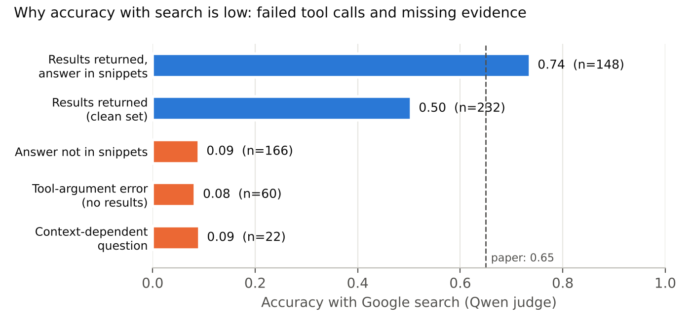

# Does Seeing the Search Result Make Tool Utility Predictable?

A diagnostic follow-up to *To Call or Not to Call* (Wu et al., 2026, [arXiv:2605.00737](https://arxiv.org/abs/2605.00737)), built on the authors' released harness ([ToCall_or_NotToCall](https://github.com/QinyuanWu0710/ToCall_or_NotToCall)).

**Question.** The paper finds that hidden-state probes predict tool *need* well but tool *utility* less well, and attributes this to utility depending on the tool output. We test (Q1) whether the utility labels are simply noisy and (Q2) how much utility prediction improves once the probe can see the retrieved results.

## Main results (Llama-3.2-3B-Instruct, BFCL web search, clean set n = 229)

| | AUROC [95% CI] |
|---|---|
| Need probe (LNE) | 0.90 |
| Utility probe, **pre**-search state | 0.60 [0.52, 0.67] |
| Utility probe, **post**-search state (sees results) | 0.75 [0.68, 0.81] |
| Difference (paired bootstrap) | **+0.15 [0.06, 0.24]** |

- **Q1:** utility labels re-judged 3×: Fleiss κ 0.97 [0.94, 0.99]. Repeated judgments are highly consistent, so repeat-to-repeat disagreement alone is unlikely to explain the gap. This measures judge *consistency*. For *correctness*, an independent second model (Claude) labelled the 48 of 50 answers it could resolve blind to the judge (2 truncated in logging and excluded; stratified sample): agreement 44/48 = 92%, Cohen's κ 0.83; the judge errs on the strict side (3 of 4 disagreements). See `results/judge_crosscheck.json`.
- **Q2:** seeing the evidence significantly improves utility prediction, but substantial predictive difficulty remains.
- Full uncleaned set (n = 308), same direction: 0.68 → 0.82, +0.14 [0.07, 0.21].


## Data-quality findings (always-search, Google)
- 60/314 runs (19%): the model called the search tool with a wrong argument name, so the harness returned an error string instead of results (accuracy 0.08). **This is in the base local loop and may be harness-specific — see Differences.**
- 22 context-dependent questions ("Where is his hometown?") cannot be answered standalone (accuracy 0.09).
- Time-sensitive questions are **not** the cause of lower accuracy (0.41 current/latest vs 0.41 stable).
- Clean set accuracy: 0.12 without the tool, 0.50 with Google (paper: 0.17 / 0.65). Across all 314 runs, the gold answer string appears in the retrieved snippets for 47% of questions (accuracy 0.74 when it does, 0.09 when not; the second group includes the 60 runs that received no results).



Error strings in the post-search prompt would be an easy cue for "search did not help", which is why Q2 is reported on the clean set, with the full set alongside.

## Differences from the original setup
- Judge: the paper's exact BFCL judge prompt, run on Qwen2.5-7B-Instruct (4-bit, temperature 1.0) instead of GPT-4o.
- Model: ungated `unsloth/Llama-3.2-3B-Instruct` (same weights).
- Searches run in October 2026 via SerpAPI.
- Temperature 0 (repo default is 1.0).
- One engine (Google) and one model.
- **Harness: the base local loop (the repo's recommended vLLM path) rather than the chat-template harness the paper uses for Llama-3.2-3B. This may itself cause the 19% tool-argument errors and the lower always-search accuracy; a chat-harness re-run is the top priority.**

## Reproduce (free Colab T4)
```bash
git clone https://github.com/QinyuanWu0710/ToCall_or_NotToCall ../ToCall_or_NotToCall
pip install -r ../ToCall_or_NotToCall/requirements.txt bitsandbytes accelerate
export HF_TOKEN=...  SERPAPI_API_KEY=...          # never commit keys
LIMIT=314 MODEL=unsloth/Llama-3.2-3B-Instruct bash scripts/generate.sh
bash scripts/judge_all.sh                          # local Qwen judge, K=3
python src/extract_hidden.py --runs runs --model unsloth/Llama-3.2-3B-Instruct --out data/hidden.npz
python src/diagnostics.py --runs runs --judgments data/judgments.jsonl --gt ../ToCall_or_NotToCall/data/BFCL.csv --hidden data/hidden.npz --out data/clean
python src/analyze.py --runs runs --judgments data/clean/judgments.jsonl --hidden data/clean/hidden.npz --out results_clean
python tests/test_analysis.py                      # synthetic sanity tests
```
All commands above run on a free Colab T4 GPU (about 1.5 h for 314 questions).

**Reproducibility note.** The reported numbers were computed in Colab; the clean-set filtering, CIs and the re-run of quota-failed searches were done interactively there. `src/diagnostics.py` packages those steps but has not yet been re-run end to end on the raw outputs, and the raw outputs are not in this repo (see below). The summary JSONs in `results/` are the reported values.

## Planned controls (designed, not yet run)
To test whether the +0.15 reflects evidence content rather than (a) label noise, (b) known answer-correctness probing, or (c) prompt format/position, three controls are implemented in `src/control_experiments.py` (see `EXPERIMENTS.md`): a lexical "gold-in-snippets" baseline; a correctness-decomposition (POST probe trained to predict answer correctness vs. utility on the same states); and a mismatched-evidence control that swaps each question's snippets for another's while holding format and position fixed. Results will appear in `results/control/`.

## Method details
- **Probes:** the paper's MLP grid (hidden sizes {(),128,256,(128,64),(1024,64)} × lr {1e-3,1e-4}), standardized final-layer last-token states.
- **Cross-validation:** nested; hyperparameters are selected inside each training fold, with identical outer folds for pre and post, seed 42.
- **Statistics:**
  - bootstrap 95% CIs over questions;
  - a paired bootstrap that resamples the same questions for both probes;
  - Fleiss κ and flip rate over judge repeats.
- **Judge-agreement reference:** a leave-one-repeat-out AUROC between judge repeats. It reflects judge consistency only, not a theoretical maximum.

## Layout
`src/` analysis code · `scripts/` generation + judging · `tests/` sanity tests · `results/` summary JSONs · `report/` two-page write-up.
Raw harness outputs are not included: retrieved prompts may contain API request URLs.

Contact: Anchal Singh Parihar (SRM University, Sonipat)
