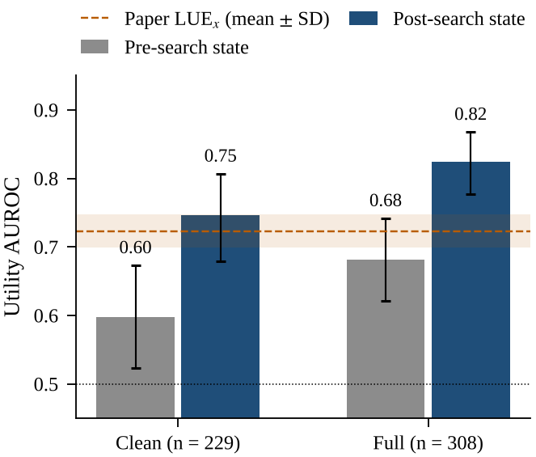
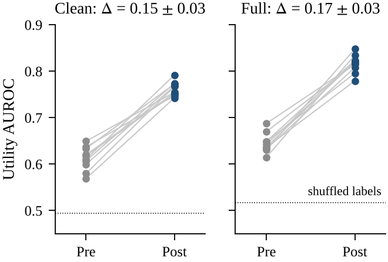
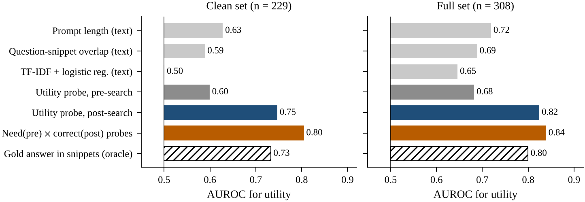
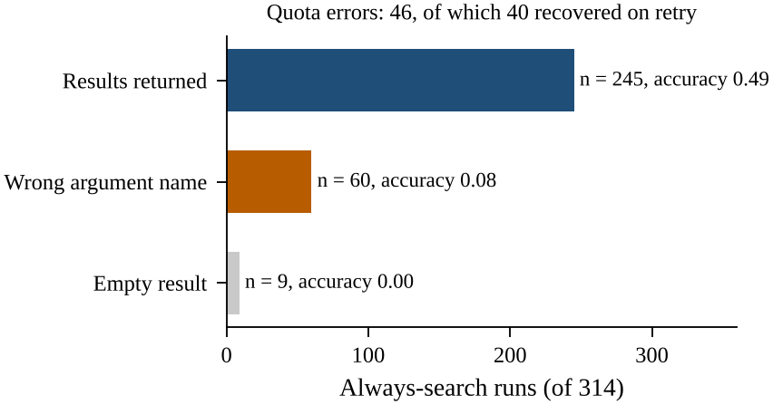

# Does Seeing the Search Result Make Tool Utility Predictable?

Anchal Singh Parihar, SRM University, Sonipat · [Report (PDF)](report/Report_ToolUtility.pdf)

A diagnostic follow-up to *To Call or Not to Call* (Wu et al., 2026, [arXiv:2605.00737](https://arxiv.org/abs/2605.00737)), built on the authors' released harness ([ToCall_or_NotToCall](https://github.com/QinyuanWu0710/ToCall_or_NotToCall)).

## Summary

Wu et al. find that hidden-state probes predict whether a tool is *needed* well, but whether calling it will *help* (utility) much less well. We ask (Q1) whether this is because the utility labels are noisy, and (Q2) how much utility prediction improves once the probe reads the hidden state after the search results are in the prompt, and why.

On Llama-3.2-3B-Instruct with forced Google search on BFCL:

- Utility labels are consistent across judge repeats (Fleiss κ = 0.97), so label noise does not explain the gap.
- A probe on the post-search state predicts utility better than one on the pre-search state: AUROC 0.60 → 0.75 on the clean set, +0.15 ± 0.03 over 10 seeds, positive for every seed, and above text-only baselines on the same prompt.
- The gain is explained by need and answer correctness. Utility here equals need × correctness, and the product of a pre-search need probe and a post-search correctness probe predicts utility at least as well as the post-search utility probe (0.80 vs. 0.75). The post-search state mainly encodes whether the upcoming answer will be correct, which is close to whether the answer appears in the snippets.

<p align="center"> </p>

## Results

Clean set: n = 229 questions (full set, n = 308, in brackets). Pooled out-of-fold AUROC with 95% bootstrap CIs, seed 42; the paper reports the mean ± SD over folds, which we give in the second column.

| | Ours, pooled [95% CI] | Ours, fold mean ± SD | Wu et al., Table 4 |
|---|---|---|---|
| Need probe, pre-search (LNE) | 0.90 [0.86, 0.94] (0.91) | 0.92 ± 0.05 (0.93 ± 0.03) | 0.81 ± 0.04 |
| Utility probe, pre-search (LUE_x) | 0.60 [0.52, 0.67] (0.68) | 0.63 ± 0.15 (0.69 ± 0.07) | 0.72 ± 0.02 |
| Utility probe, post-search | 0.75 [0.68, 0.81] (0.82) | | — |
| Difference, paired bootstrap | +0.15 [0.06, 0.24] (+0.14 [0.07, 0.21]) | | |
| Difference, 10 seeds | +0.15 ± 0.03, min +0.11 (+0.17 ± 0.03) | | |

With the paper's aggregation, our full-set pre-search utility probe (0.69 ± 0.07) is within about one SD of the paper's 0.72 ± 0.02. Judge, harness and search date differ (see below), so we compare effect sizes rather than exact values.

### What explains the gain

<p align="center"></p>

| | Clean | Full |
|---|---|---|
| Text-only baselines on the post-search prompt (length / overlap / TF-IDF) | 0.63 / 0.59 / 0.50 | 0.72 / 0.69 / 0.65 |
| Post-search probe, utility | 0.75 | 0.82 |
| Inside need = 1, where utility = correctness: pre → post | 0.65 → 0.84 (+0.19 [0.11, 0.28]) | 0.68 → 0.88 (+0.20 [0.13, 0.26]) |
| Post-search probe, correctness of the search answer | 0.82 | 0.87 |
| Need (pre) × correctness (post), utility | 0.80 (beats post-search utility probe by 0.06 [0.01, 0.11]) | 0.84 (difference n.s.) |
| Gold answer in snippets (uses the gold answer; reference only) | 0.73 | 0.80 |
| Post-search probe with shuffled labels (20 permutations) | 0.49 | 0.52 |

The post-search utility probe carries no detectable signal beyond need and answer correctness. This is consistent with prior work showing that LLMs encode their own answer correctness (Kadavath et al., 2022; Orgad et al., 2025); we do not claim a new utility-specific signal.

### Label reliability (Q1)

Utility labels across three judge repeats: Fleiss κ 0.97 [0.94, 0.99], per-question flip rate 0.02. This measures consistency, not correctness. A second LLM (Claude, not humans), blind to the judge, labelled a stratified sample of 50 answers and agreed on 45 (0.90, Cohen's κ 0.80). The two answers that were first logged truncated (ids 23 and 37) were resolved by reading them in full; excluding them instead gives 44/48 (0.92, κ 0.83). Most disagreements are the judge marking a correct answer wrong.

## Data quality and harness behaviour

<p align="center"></p>

- In 60 of 314 forced-search runs (19%) the model called `web_search` with the argument `search_query`. In the base loop, `ToolManager.arguments_from_input` passes the model's argument dictionary through unchanged, the search function raises a `TypeError`, and the prompt receives an error string instead of results (accuracy 0.08).
- 46 searches hit the SerpAPI free quota; 40 returned results when re-run about two hours later. 9 runs ended with an empty result.
- 22 questions refer to an unnamed entity ("Where is his hometown?"); accuracy 0.09.
- Time sensitivity does not explain accuracy (0.41 current/latest, 0.37 fixed year, 0.41 stable).
- The gold answer appears in the snippets for 47% of runs (accuracy 0.74 when it does, 0.09 when it does not).

The clean set drops the argument-error runs, the 22 context-dependent questions and two runs flagged as quota errors by a substring match (both actually had results); 229 questions remain. The rule was fixed after inspecting accuracy by failure type, so it is post hoc; the full set is reported alongside. Every excluded question and its reason: `results/generated/diagnostics/exclusions.csv`.

## Differences from the original setup

- Judge: the paper's BFCL judge prompt on Qwen2.5-7B-Instruct (4-bit, temperature 1.0, K = 3) instead of GPT-4o.
- Harness: the base local loop rather than the chat-template harness the paper uses for Llama-3.2-3B. A 50-question pilot with the chat template returned raw tool-call JSON as the final answer (accuracy 0.24).
- Model `unsloth/Llama-3.2-3B-Instruct` (same weights, ungated), temperature 0, Google via SerpAPI in October 2026, one model and one task.

## Verification and corrections

All numbers above were regenerated from the raw run files (kept off GitHub because they contain API request URLs). `src/make_results.py` rebuilds the reported summaries and compares them number by number: 74 of 74 match (`results/generated/comparison.json`). The remaining reported values (time sensitivity, gold-in-snippets, context-dependent accuracy) were recomputed with the original Colab code and also match. Per-question out-of-fold scores match those saved in Colab to within 1e-4.

Two earlier statements were wrong and are corrected here. "114 searches hit HTTP 429, 112 were fixed" came from a substring filter that also caught the argument-error runs; the recorded tool results give 46 quota errors, 40 recovered (`results/remediation/retry_audit.json`). The cross-check was earlier reported only as 44/48; both versions are given above.

Not yet done: counting judge outputs that failed to parse (they were scored as wrong and not logged), a mismatched-evidence control, the chat-template harness, a GPT-4o judge and human labels. Full log of how each number was produced: [docs/PROVENANCE.md](docs/PROVENANCE.md); plan: [docs/REMEDIATION_PLAN.md](docs/REMEDIATION_PLAN.md); changes: [CHANGES.md](CHANGES.md).

## Reproduce

Generation, judging and hidden states (free Colab T4, about 1.5 h):
```bash
git clone https://github.com/QinyuanWu0710/ToCall_or_NotToCall ../ToCall_or_NotToCall
pip install -r ../ToCall_or_NotToCall/requirements.txt bitsandbytes accelerate
export HF_TOKEN=...  SERPAPI_API_KEY=...          # never commit keys
LIMIT=314 MODEL=unsloth/Llama-3.2-3B-Instruct bash scripts/generate.sh
bash scripts/judge_all.sh                          # local Qwen judge, K=3
python src/extract_hidden.py --runs runs --model unsloth/Llama-3.2-3B-Instruct --out data/hidden.npz
```
All results, controls and figures from those files (CPU, about 1 h):
```bash
GT=../ToCall_or_NotToCall/data/BFCL.csv
python src/make_results.py --runs runs --judgments data/judgments.jsonl --gt $GT \
    --hidden data/hidden.npz --crosscheck-csv results/crosscheck_labels.csv --out results/generated
C=results/generated/diagnostics
for T in "clean $C/hidden.npz $C/judgments.jsonl" "full data/hidden.npz data/judgments.jsonl"; do set -- $T
  for A in foldmean stratify seeds; do
    python src/remediation.py $A --hidden $2 --judgments $3 --out results/remediation/${A}_$1.json
  done
  python src/remediation.py textonly --runs runs --gt $GT --judgments $3 --hidden $2 --out results/remediation/textonly_$1.json
done
python src/retry_audit.py --before runs_before_retry/force_google_with429.jsonl --after runs/force_google.jsonl \
    --retried data/failed_search_questions.json --out results/remediation/retry_audit.json
python scripts/make_figures.py --runs runs --judgments data/judgments.jsonl
cd report && pdflatex report.tex && pdflatex report.tex
```

## Method

Probes follow the paper's App. E: MLP grid (hidden sizes {(), 128, 256, (128, 64), (1024, 64)} × learning rate {1e-3, 1e-4}) on the standardised last-token, final-layer state; nested 5-fold stratified cross-validation with identical outer folds for all probes. Pre-search = end of the no-tool prompt; post-search = end of the forced-search final prompt containing the snippets. Need = no-tool answer judged wrong; utility = search answer judged right and no-tool answer judged wrong (judge repeat 0). Statistics: question-level bootstrap CIs, paired bootstrap for differences, Fleiss κ over judge repeats.

## Layout

`src/` analysis · `scripts/` generation, judging, figures · `tests/` synthetic tests · `results/` reported summaries, with `generated/` and `remediation/` regenerated from raw data · `figures/` · `report/` LaTeX report · `docs/` provenance, paper comparison, plan.

## References

- Q. Wu, S. Lee, S. Das, M. Amani, A. Nag, K. Gummadi, A. Ravichander, M. B. Zafar. *To Call or Not to Call: A Framework to Assess and Optimize LLM Tool Calling.* arXiv:2605.00737, 2026.
- S. Kadavath et al. *Language Models (Mostly) Know What They Know.* arXiv:2207.05221, 2022.
- H. Orgad et al. *LLMs Know More Than They Show: On the Intrinsic Representation of LLM Hallucinations.* ICLR 2025.
